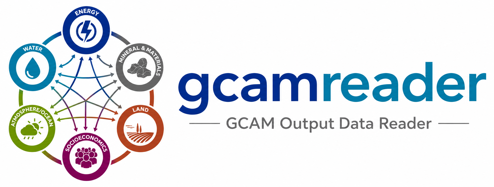

<p align="center">
  
</p>

[](https://github.com/JGCRI/gcamreader/actions/workflows/build.yml)
[](https://github.com/JGCRI/gcamreader/actions/workflows/docs.yml)
[](https://github.com/JGCRI/gcamreader/actions/workflows/lint.yml)
[](https://zenodo.org/badge/latestdoi/100425913)

# gcamreader: a Python package for extracting content from GCAM databases

`gcamreader` provides functions for reading data from the output databases
produced by [GCAM](https://github.com/JGCRI/gcam-core).

## Purpose

`gcamreader` was created to:

- Use XML queries to extract data into a pandas DataFrame from a GCAM XML
  database.
- Integrate GCAM with other Python packages.

## Requirements

- Python 3.11 or newer.
- A Java runtime (JRE). `gcamreader` runs queries against local databases using
  a bundled copy of the GCAM ModelInterface, which requires Java. Remote queries
  use the BaseX REST API and also rely on a server running ModelInterface.
  Java 8 or newer works (the bundled jars are Java 8 class files); the project
  is tested with Temurin 17. The structural comparison commands look for Java
  in `GCAMREADER_JAVA`, then `JAVA_HOME`, then `PATH`, so a user-space JRE can
  be used where Java cannot be installed system-wide. No JRE is bundled.

## Installation

### Set up a virtual environment

It is recommended to install `gcamreader` into an isolated virtual environment
to avoid conflicts with other packages on your system.

Using the built-in `venv` module:

```bash
# Create a virtual environment in a directory named ".venv".
python -m venv .venv

# Activate it (macOS / Linux).
source .venv/bin/activate

# Activate it (Windows PowerShell).
.venv\Scripts\Activate.ps1
```

Alternatively, with `conda`:

```bash
conda create -n gcamreader python=3.11
conda activate gcamreader
```

Once the environment is activated, install `gcamreader` using one of the
methods below. To leave the environment when you are finished, run `deactivate`
(`venv`) or `conda deactivate` (`conda`).

Install the latest release from PyPI:

```bash
pip install gcamreader
```

Install the development version from source:

```bash
git clone https://github.com/JGCRI/gcamreader.git
cd gcamreader
pip install -e .
```

To work on the package, install the development and documentation extras:

```bash
pip install -e ".[dev,docs]"
```

## Quickstart

### Query a local database

```python
import gcamreader

# Connect to a local GCAM database (the parent directory and database name).
conn = gcamreader.LocalDBConn("path/to/output", "database_basexdb")

# List the scenarios contained in the database.
scenarios = conn.listScenariosInDB()

# Parse a GCAM queries XML file and run the first query.
queries = gcamreader.parse_batch_query("Main_queries.xml")
df = conn.runQuery(queries[0])
```

### Run many queries at once

```python
import gcamreader

results = gcamreader.importdata(
    "path/to/output/database_basexdb",
    "Main_queries.xml",
)

# results is a dict keyed by query title, with DataFrame values.
for title, frame in results.items():
    print(title, None if frame is None else frame.shape)
```

### Query a remote database

```python
import gcamreader

conn = gcamreader.RemoteDBConn(
    dbfile="database_basexdb",
    username="user",
    password="secret",
    address="localhost",
    port=8984,
)
df = conn.runQuery(gcamreader.parse_batch_query("Main_queries.xml")[0])
```

## Command line interface

`gcamreader` installs a `gcamreader` command for running the queries in a
queries file and saving each result to a CSV file.

```bash
# Show the version.
gcamreader --version

# Query a local database and write CSV outputs to a directory.
gcamreader local \
    --database_path path/to/output/database_basexdb \
    --query_path Main_queries.xml \
    --output_path results/ \
    --force

# Query a remote BaseX server.
gcamreader remote \
    --username user \
    --database_name database_basexdb \
    --query_path Main_queries.xml \
    --output_path results/ \
    --hostname localhost \
    --port 8984
```

Use `gcamreader --help`, `gcamreader local --help`, or
`gcamreader remote --help` for the full list of options.

## Comparing database structure

`gcamreader diff` compares the *structure* of two or more local output
databases: which regions, sectors, technologies, inputs, years and other
elements exist and which metadata attributes they carry. Numeric values are
ignored. The result is a Markdown report (with a matrix across inputs and an
appendix for long lists) and optionally a JSON file.

```bash
# Which runs does each database hold? Only needed when a database has several.
gcamreader scenarios output/database_basexdb_ref output/database_basexdb_policy

# Compare; keep the structure indexes so later comparisons are fast.
gcamreader diff output/database_basexdb_ref output/database_basexdb_policy \
    -o report.md --json result.json --work-dir ~/.cache/gcamreader-structure
echo $?   # 0: identical structure, 1: differences found, 2: error
```

```python
import gcamreader

result = gcamreader.compare_databases(
    ["output/database_basexdb_ref", "output/database_basexdb_policy"]
)
print(result.has_differences)
for finding in result.comparisons[0].findings:
    print(finding.kind.value, finding.path)
report = gcamreader.render_markdown(result)
```

Only local databases are supported. See the
[documentation](https://jgcri.github.io/gcamreader/structure_comparison.html)
for the comparison rules, counting definitions, report layout, performance and
limitations.

## Documentation

Full documentation, including the API reference, is available at
[https://jgcri.github.io/gcamreader/](https://jgcri.github.io/gcamreader/).

## Contributing

Contributions are welcome. Please run the test suite and the linters before
opening a pull request:

```bash
pytest
ruff check .
black --check .
```

## Citation

If you use `gcamreader` in your work, please cite it using the DOI badge above.

## License

`gcamreader` is released under the BSD 2-Clause License. See the
[LICENSE](LICENSE) file for details.
